<div align="center">

# @crownone/ui

**The shared React Native / Expo component library for Crown One apps.**

Themed atoms and molecules with light and dark mode built in, so every Crown One app looks and behaves the same.

[](https://www.npmjs.com/package/@crownone/ui)
[](#license)


[](https://snack.expo.dev/?name=%40crownone%2Fui%20Playground&description=Interactive%20playground%20for%20%40crownone%2Fui&files=%7B%22App.js%22%3A%7B%22type%22%3A%22CODE%22%2C%22url%22%3A%22https%3A%2F%2Fraw.githubusercontent.com%2Fhammadev%2Fcrownone-ui%2Fmain%2Fexamples%2FPlayground.js%22%7D%2C%22focus.js%22%3A%7B%22type%22%3A%22CODE%22%2C%22contents%22%3A%22export%20default%20null%3B%5Cn%22%7D%7D&dependencies=%40crownone%2Fui,expo-font,expo-blur,expo-image,expo-linear-gradient,react-native-reanimated,react-native-safe-area-context,react-native-size-matters,%40expo%2Fvector-icons)

<br />

<table>
  <tr>
    <td><a href="#styledbutton">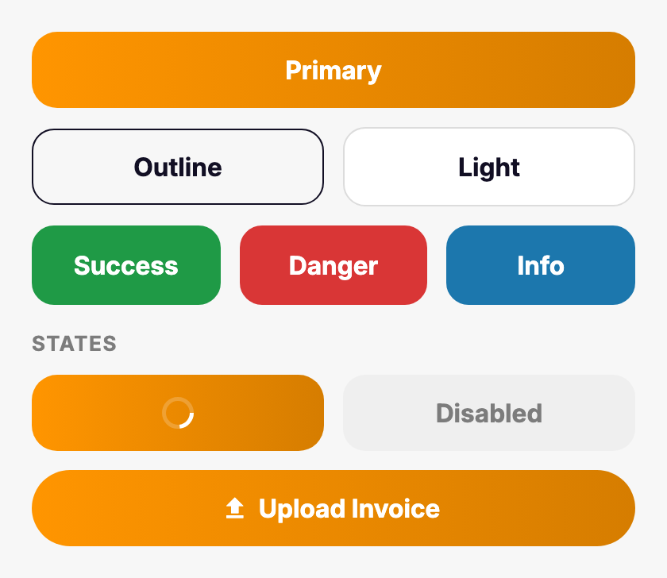</a></td>
    <td><a href="#statuscard">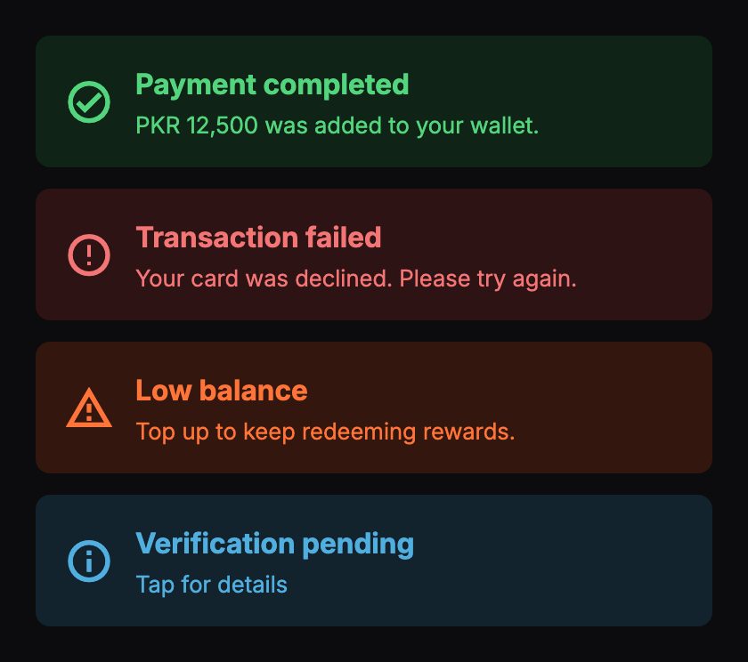</a></td>
    <td><a href="#styledtextfield">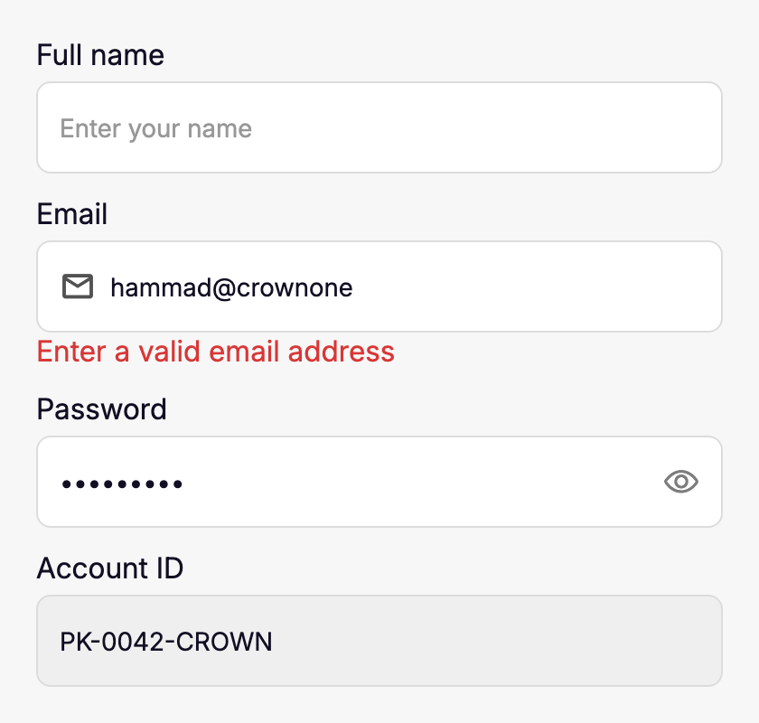</a></td>
  </tr>
  <tr>
    <td><a href="#styledchip">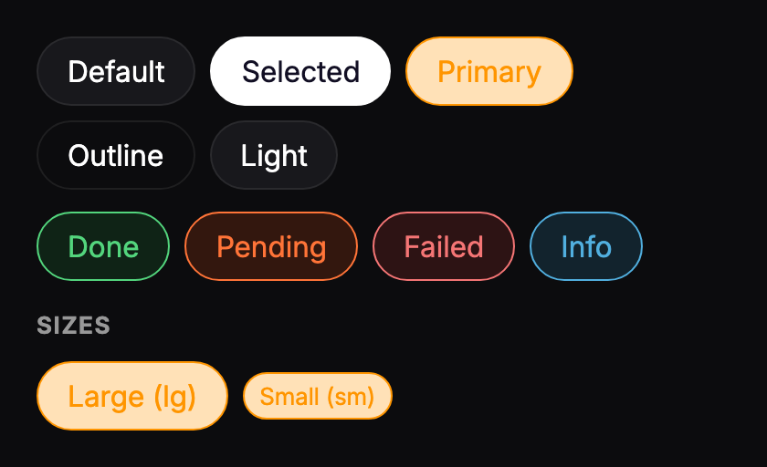</a></td>
    <td><a href="#styledcard">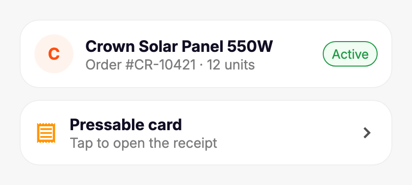</a></td>
    <td><a href="#blurmodalbackdrop">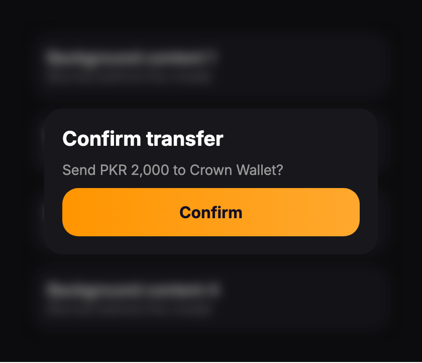</a></td>
  </tr>
</table>

</div>

---

## Table of Contents

- [Features](#features)
- [Requirements](#requirements)
- [Installation](#installation)
- [Quick Start](#quick-start)
  - [1. Load the fonts](#1-load-the-fonts)
  - [2. Add the ThemeProvider](#2-add-the-themeprovider)
  - [3. Use a component](#3-use-a-component)
- [Live Playground](#live-playground)
- [Components](#components)

  | Typography & Media | Actions | Inputs | Feedback | Layout |
  |---|---|---|---|---|
  | [StyledText](#styledtext) | [StyledButton](#styledbutton) | [StyledTextField](#styledtextfield) | [StatusCard](#statuscard) | [StyledCard](#styledcard) |
  | [StyledImage](#styledimage) | [StyledChip](#styledchip) | [SearchBar](#searchbar) | [LoadingComponent](#loadingcomponent) | [OrDivider](#ordivider) |
  | [StyledIcon](#styledicon) | [StyledTabs](#styledtabs) | [StyledDropdown](#styleddropdown) | [Skeleton](#skeleton) | [BottomActionsBar](#bottomactionsbar) |
  | [AlphabetAvatar](#alphabetavatar) | | [StyledCheckbox](#styledcheckbox) | [FieldError](#fielderror) | [BlurModalBackdrop](#blurmodalbackdrop) |
  | | | [StyledRadioButton](#styledradiobutton) | [EmptyListComponent](#emptylistcomponent) | [SummaryValueCard](#summaryvaluecard) |
  | | | | | [DateGroupedList](#dategroupedlist) |
  | | | | | [AlphabetGroupedList](#alphabetgroupedlist) |

- [Theming](#theming)
  - [Translations](#translations)
- [Utilities](#utilities)
- [Optional Entry Points](#optional-entry-points)
- [TypeScript](#typescript)
- [Peer Dependencies](#peer-dependencies)
- [Using with AI Assistants](#using-with-ai-assistants)
- [Contributing](#contributing)
- [Releasing](#releasing)
- [License](#license)

> **About the previews:** every image in this README is a real render of the component, not a mockup. Images switch between light and dark to match your GitHub theme. Each section's code block reproduces the preview.

---

## Features

- **25 production components.** These are the same components used across the Crown One apps, including grouped lists and a shareable receipt.
- **Light and dark mode.** Every component reads its colors from a single theme object.
- **Custom themes.** Override any color token (e.g. brand colors) without touching component code.
- **Typed.** Full TypeScript definitions, including generic `StyledDropdown<T>` and `StyledTabs<Key>`.
- **Cross-platform.** iOS, Android and Web, with platform-specific implementations where needed (e.g. `StyledImage`, `StyledDropdown`).
- **Built for forms.** `StyledTextField` and `StyledDropdown` read `react-hook-form` errors directly.
- **Built-in safeguards.** Pressable components ignore accidental double-taps, and `BottomActionsBar` respects safe areas.
- **Translatable.** The few words components render themselves ("Cancel", "OR", "No record found"…) can be translated once through `ThemeProvider`.
- **Test IDs.** `StyledButton` and `StyledTextField` generate a `testID` from their title or label.

---

## Requirements

| Dependency | Version |
|---|---|
| React | `>= 18` |
| React Native | `>= 0.73` |
| Expo SDK | `>= 50` |

---

## Installation

```bash
npm install @crownone/ui
```

Then install the peer dependencies. Skip any that your project already has.

```bash
npx expo install \
  @expo/vector-icons \
  expo-blur \
  expo-image \
  expo-linear-gradient \
  react-native-reanimated \
  react-native-safe-area-context \
  react-native-size-matters
```

> `react-native-reanimated` needs its Babel plugin. Recent Expo SDK versions configure it automatically through `babel-preset-expo`. See the [Reanimated install guide](https://docs.swmansion.com/react-native-reanimated/docs/fundamentals/getting-started/) if you use a custom Babel config.

---

## Quick Start

### 1. Load the fonts

Components use the **Inter** font family. On iOS and Android, load the font files under these **exact** family names before rendering any component:

```tsx
// app/_layout.tsx
import { useFonts } from 'expo-font';
import * as SplashScreen from 'expo-splash-screen';
import { useEffect } from 'react';

SplashScreen.preventAutoHideAsync();

export default function RootLayout() {
  const [loaded] = useFonts({
    inter_light:    require('../assets/fonts/Inter-Light.ttf'),
    inter_regular:  require('../assets/fonts/Inter-Regular.ttf'),
    inter_medium:   require('../assets/fonts/Inter-Medium.ttf'),
    inter_semiBold: require('../assets/fonts/Inter-SemiBold.ttf'),
    inter_bold:     require('../assets/fonts/Inter-Bold.ttf'),
  });

  useEffect(() => {
    if (loaded) SplashScreen.hideAsync();
  }, [loaded]);

  if (!loaded) return null;

  return <App />;
}
```

Download the font files from [rsms.me/inter](https://rsms.me/inter/) and put the `.ttf` files in `assets/fonts/`.

> **Web:** on web, components use the CSS font family `Inter`. If Inter isn't loaded on the page, the browser falls back to the system sans-serif font.

### 2. Add the ThemeProvider

```tsx
import { ThemeProvider } from '@crownone/ui';
import { useColorScheme } from 'react-native';

export default function App() {
  const scheme = useColorScheme();

  return (
    <ThemeProvider dark={scheme === 'dark'}>
      {/* your app */}
    </ThemeProvider>
  );
}
```

Without a provider, components fall back to the **light theme**.

### 3. Use a component

```tsx
import { StyledButton, StyledText } from '@crownone/ui';

export function Welcome() {
  return (
    <>
      <StyledText h4>Welcome to Crown One</StyledText>
      <StyledButton title="Get started" onPress={() => {}} />
    </>
  );
}
```

---

## Live Playground

Try every component without installing anything. The playground runs in [Expo Snack](https://snack.expo.dev): use it in the browser, or scan the QR code with **Expo Go** to run it on your phone.

<p align="center">
  <a href="https://snack.expo.dev/?name=%40crownone%2Fui%20Playground&description=Interactive%20playground%20for%20%40crownone%2Fui&files=%7B%22App.js%22%3A%7B%22type%22%3A%22CODE%22%2C%22url%22%3A%22https%3A%2F%2Fraw.githubusercontent.com%2Fhammadev%2Fcrownone-ui%2Fmain%2Fexamples%2FPlayground.js%22%7D%2C%22focus.js%22%3A%7B%22type%22%3A%22CODE%22%2C%22contents%22%3A%22export%20default%20null%3B%5Cn%22%7D%7D&dependencies=%40crownone%2Fui,expo-font,expo-blur,expo-image,expo-linear-gradient,react-native-reanimated,react-native-safe-area-context,react-native-size-matters,%40expo%2Fvector-icons">
    
  </a>
</p>

What you can try:

- Switch between **light and dark** mode live.
- Submit the form empty to see `StyledTextField` and `FieldError` validation.
- Filter a list with `SearchBar`, select chips, radios, tabs and the dropdown.
- Toggle the `Skeleton` loading state, open the `BlurModalBackdrop` modal, and use the sticky `BottomActionsBar`.

Each component below also has a **▶ Try it live** button. It opens the same playground, scrolled to that component's section with the section outlined.

The playground's source is [`examples/Playground.js`](./examples/Playground.js) in this repo. Snack loads it from the `main` branch and always uses the latest published `@crownone/ui`.

---

## Components

All components are named exports from the package root:

```tsx
import { StyledButton, StyledText, StatusCard /* … */ } from '@crownone/ui';
```

---

### StyledText

The base text component. It supports a full typographic scale, shorthand props for common styles, and colors from the theme.

<p align="center">
  <picture>
    <source media="(prefers-color-scheme: dark)" srcset="https://raw.githubusercontent.com/hammadev/crownone-ui/main/docs/images/text-dark.png">
    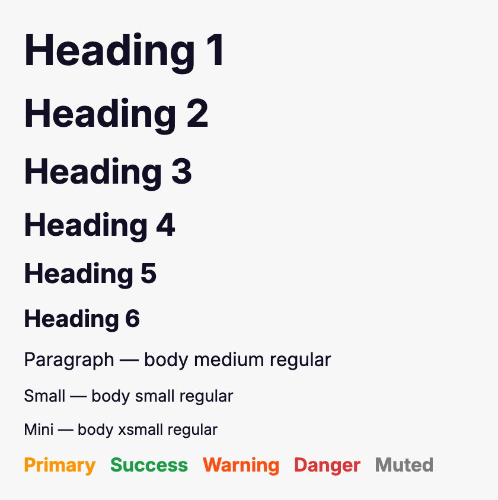
  </picture>
</p>

<p align="center">
  <a href="https://snack.expo.dev/?name=%40crownone%2Fui%20%E2%80%94%20StyledText&description=Interactive%20playground%20for%20%40crownone%2Fui&files=%7B%22App.js%22%3A%7B%22type%22%3A%22CODE%22%2C%22url%22%3A%22https%3A%2F%2Fraw.githubusercontent.com%2Fhammadev%2Fcrownone-ui%2Fmain%2Fexamples%2FPlayground.js%22%7D%2C%22focus.js%22%3A%7B%22type%22%3A%22CODE%22%2C%22contents%22%3A%22export%20default%20%27StyledText%27%3B%5Cn%22%7D%7D&dependencies=%40crownone%2Fui,expo-font,expo-blur,expo-image,expo-linear-gradient,react-native-reanimated,react-native-safe-area-context,react-native-size-matters,%40expo%2Fvector-icons">
    
  </a>
</p>

```tsx
import { StyledText } from '@crownone/ui';

// Headings
<StyledText h1>Heading 1</StyledText>
<StyledText h2>Heading 2</StyledText>
<StyledText h3>Heading 3</StyledText>
<StyledText h4>Heading 4</StyledText>
<StyledText h5>Heading 5</StyledText>
<StyledText h6>Heading 6</StyledText>

// Body
<StyledText p>Paragraph — body medium regular</StyledText>
<StyledText small>Small — body small regular</StyledText>
<StyledText mini>Mini — body xsmall regular</StyledText>

// Colors: theme key, palette key, or any color value
<StyledText primary bold>Primary</StyledText>
<StyledText textColor="success" bold>Success</StyledText>
<StyledText textColor="danger" bold>Danger</StyledText>
<StyledText textColor="textMuted">Muted</StyledText>
<StyledText textColor="#FF6600">Custom hex</StyledText>

// Exact variant
<StyledText variant="bodyLargeBold">Body large bold</StyledText>
```

| Prop | Type | Default | Description |
|---|---|---|---|
| `variant` | `TextVariant` | — | Exact variant, e.g. `"heading1Bold"`, `"bodySmallRegular"` |
| `h1` – `h6` | `boolean` | — | Heading shortcuts |
| `p` | `boolean` | — | Body medium regular |
| `small` | `boolean` | — | Body small regular |
| `mini` | `boolean` | — | Body xsmall regular |
| `bold` | `boolean` | — | Switches the current size to its bold variant |
| `primary` | `boolean` | — | Uses `theme.colors.primary` |
| `textColor` | `string` | `theme.colors.text` | Theme color key, palette key, or any color value |

**Available variants:** `heading1`–`heading6`, `bodyLarge`, `bodyMedium`, `bodySmall`, `bodyXSmall`, `bodyXXSmall`, each with a `Bold` or `Regular` suffix (e.g. `heading3Bold`, `bodyXSmallRegular`).

All React Native `Text` props (`numberOfLines`, `onPress`, `style`, …) are also accepted.

---

### StyledImage

An image component that shows a loading indicator and falls back to a placeholder on error. It's backed by `expo-image` on iOS and Android, and by React Native's `Image` on web.

<p align="center">
  <picture>
    <source media="(prefers-color-scheme: dark)" srcset="https://raw.githubusercontent.com/hammadev/crownone-ui/main/docs/images/image-dark.png">
    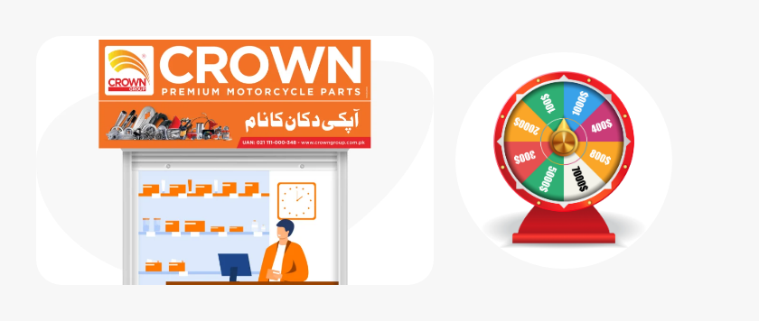
  </picture>
</p>

<p align="center">
  <a href="https://snack.expo.dev/?name=%40crownone%2Fui%20%E2%80%94%20StyledImage&description=Interactive%20playground%20for%20%40crownone%2Fui&files=%7B%22App.js%22%3A%7B%22type%22%3A%22CODE%22%2C%22url%22%3A%22https%3A%2F%2Fraw.githubusercontent.com%2Fhammadev%2Fcrownone-ui%2Fmain%2Fexamples%2FPlayground.js%22%7D%2C%22focus.js%22%3A%7B%22type%22%3A%22CODE%22%2C%22contents%22%3A%22export%20default%20%27StyledImage%27%3B%5Cn%22%7D%7D&dependencies=%40crownone%2Fui,expo-font,expo-blur,expo-image,expo-linear-gradient,react-native-reanimated,react-native-safe-area-context,react-native-size-matters,%40expo%2Fvector-icons">
    
  </a>
</p>

```tsx
import { StyledImage } from '@crownone/ui';

// Rounded tile
<StyledImage
  source={require('./assets/shop-board.webp')}
  contentFit="cover"
  style={{ width: 220, height: 138, borderRadius: 14 }}
/>

// Circle
<StyledImage
  source={{ uri: 'https://example.com/photo.jpg' }}
  contentFit="contain"
  style={{ width: 120, height: 120, borderRadius: 60 }}
/>

// Placeholder on error + custom loader color
<StyledImage
  source={{ uri: user.avatarUrl }}
  placeholderSource={require('./assets/default-avatar.png')}
  loaderColor="#FF9500"
  style={{ width: 80, height: 80, borderRadius: 40 }}
/>
```

| Prop | Type | Default | Description |
|---|---|---|---|
| `source` | `ImageSource` | **required** | Remote `{ uri }` or local `require(...)` |
| `placeholderSource` | `ImageSource` | — | Shown if `source` fails to load |
| `loaderColor` | `string` | `theme.colors.primary` | Color of the loading spinner |
| `style` | `StyleProp<ImageStyle>` | — | Size, radius, and other styles for the image container |

All `expo-image` props (`contentFit`, `transition`, `cachePolicy`, …) are also accepted.

---

### StyledButton

A button with a gradient primary style, a press animation, a loading state and icon slots. Presses within 500 ms of the previous one are ignored, to block accidental double-taps.

<p align="center">
  <picture>
    <source media="(prefers-color-scheme: dark)" srcset="https://raw.githubusercontent.com/hammadev/crownone-ui/main/docs/images/button-dark.png">
    
  </picture>
</p>

<p align="center">
  <a href="https://snack.expo.dev/?name=%40crownone%2Fui%20%E2%80%94%20StyledButton&description=Interactive%20playground%20for%20%40crownone%2Fui&files=%7B%22App.js%22%3A%7B%22type%22%3A%22CODE%22%2C%22url%22%3A%22https%3A%2F%2Fraw.githubusercontent.com%2Fhammadev%2Fcrownone-ui%2Fmain%2Fexamples%2FPlayground.js%22%7D%2C%22focus.js%22%3A%7B%22type%22%3A%22CODE%22%2C%22contents%22%3A%22export%20default%20%27StyledButton%27%3B%5Cn%22%7D%7D&dependencies=%40crownone%2Fui,expo-font,expo-blur,expo-image,expo-linear-gradient,react-native-reanimated,react-native-safe-area-context,react-native-size-matters,%40expo%2Fvector-icons">
    
  </a>
</p>

```tsx
import { StyledButton, StyledIcon } from '@crownone/ui';

// Variants
<StyledButton title="Primary" onPress={fn} />
<StyledButton title="Outline" variant="outline" onPress={fn} />
<StyledButton title="Light"   variant="light"   onPress={fn} />
<StyledButton title="Success" variant="success" onPress={fn} />
<StyledButton title="Danger"  variant="danger"  onPress={fn} />
<StyledButton title="Info"    variant="info"    onPress={fn} />

// States
<StyledButton title="Loading"  loading  onPress={fn} />
<StyledButton title="Disabled" disabled onPress={fn} />

// Rounded with an icon
<StyledButton
  title="Upload Invoice"
  rounded
  leftIcon={<StyledIcon name="upload" size={18} color="#FFFFFF" />}
  onPress={fn}
/>

// Side by side: use containerStyle (not style) for flex
<StyledButton title="Success" variant="success" onPress={fn} containerStyle={{ flex: 1 }} />
```

| Prop | Type | Default | Description |
|---|---|---|---|
| `title` | `string` | **required** | Button label |
| `variant` | `StyledButtonVariant` | `"primary"` | `primary` · `outline` · `light` · `success` · `danger` · `info` |
| `onPress` | `() => void` | — | Press handler (throttled to once per second) |
| `loading` | `boolean` | `false` | Shows a spinner and disables presses |
| `disabled` | `boolean` | `false` | Muted style and disables presses |
| `rounded` | `boolean` | `false` | Fully rounded pill shape |
| `leftIcon` | `ReactNode` | — | Element before the label |
| `rightIcon` | `ReactNode` | — | Element after the label |
| `textColor` | `string` | variant default | Overrides the label color |
| `style` | `StyleProp<ViewStyle>` | — | Style for the inner button surface |
| `textStyle` | `StyleProp<TextStyle>` | — | Style for the label |
| `testID` | `string` | `btn_<title>` | Test ID for end-to-end tests |
| `containerStyle` | `StyleProp<ViewStyle>` | — | Style for the outer animated wrapper (use this for `flex`, margins) |

---

### StyledCard

A themed surface for grouping content. It renders as a pressable card when `onPress` is provided.

<p align="center">
  <picture>
    <source media="(prefers-color-scheme: dark)" srcset="https://raw.githubusercontent.com/hammadev/crownone-ui/main/docs/images/card-dark.png">
    
  </picture>
</p>

<p align="center">
  <a href="https://snack.expo.dev/?name=%40crownone%2Fui%20%E2%80%94%20StyledCard&description=Interactive%20playground%20for%20%40crownone%2Fui&files=%7B%22App.js%22%3A%7B%22type%22%3A%22CODE%22%2C%22url%22%3A%22https%3A%2F%2Fraw.githubusercontent.com%2Fhammadev%2Fcrownone-ui%2Fmain%2Fexamples%2FPlayground.js%22%7D%2C%22focus.js%22%3A%7B%22type%22%3A%22CODE%22%2C%22contents%22%3A%22export%20default%20%27StyledCard%27%3B%5Cn%22%7D%7D&dependencies=%40crownone%2Fui,expo-font,expo-blur,expo-image,expo-linear-gradient,react-native-reanimated,react-native-safe-area-context,react-native-size-matters,%40expo%2Fvector-icons">
    
  </a>
</p>

```tsx
import { AlphabetAvatar, StyledCard, StyledChip, StyledIcon, StyledText } from '@crownone/ui';

// Static card
<StyledCard>
  <View style={{ flexDirection: 'row', alignItems: 'center', gap: 12 }}>
    <AlphabetAvatar name="Crown Solar" size={40} />
    <View style={{ flex: 1 }}>
      <StyledText variant="bodyMediumBold">Crown Solar Panel 550W</StyledText>
      <StyledText small textColor="textMuted">Order #CR-10421 · 12 units</StyledText>
    </View>
    <StyledChip label="Active" variant="success" size="sm" />
  </View>
</StyledCard>

// Pressable card
<StyledCard onPress={() => router.push('/receipt')}>
  <View style={{ flexDirection: 'row', alignItems: 'center', gap: 12 }}>
    <StyledIcon name="receipt-text-outline" size={24} color={theme.colors.primary} />
    <View style={{ flex: 1 }}>
      <StyledText variant="bodyMediumBold">Pressable card</StyledText>
      <StyledText small textColor="textMuted">Tap to open the receipt</StyledText>
    </View>
    <StyledIcon name="chevron-right" size={22} />
  </View>
</StyledCard>
```

| Prop | Type | Default | Description |
|---|---|---|---|
| `children` | `ReactNode` | **required** | Card content |
| `onPress` | `() => void \| null` | — | Makes the card pressable |
| `isPressable` | `boolean` | `true` | Set `false` to keep the card static even with `onPress` |
| `style` | `StyleProp<ViewStyle>` | — | Additional styles |

---

### StyledCheckbox

A controlled checkbox whose checked and unchecked states follow the theme.

<p align="center">
  <picture>
    <source media="(prefers-color-scheme: dark)" srcset="https://raw.githubusercontent.com/hammadev/crownone-ui/main/docs/images/checkbox-dark.png">
    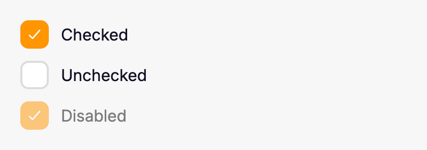
  </picture>
</p>

<p align="center">
  <a href="https://snack.expo.dev/?name=%40crownone%2Fui%20%E2%80%94%20StyledCheckbox&description=Interactive%20playground%20for%20%40crownone%2Fui&files=%7B%22App.js%22%3A%7B%22type%22%3A%22CODE%22%2C%22url%22%3A%22https%3A%2F%2Fraw.githubusercontent.com%2Fhammadev%2Fcrownone-ui%2Fmain%2Fexamples%2FPlayground.js%22%7D%2C%22focus.js%22%3A%7B%22type%22%3A%22CODE%22%2C%22contents%22%3A%22export%20default%20%27StyledCheckbox%27%3B%5Cn%22%7D%7D&dependencies=%40crownone%2Fui,expo-font,expo-blur,expo-image,expo-linear-gradient,react-native-reanimated,react-native-safe-area-context,react-native-size-matters,%40expo%2Fvector-icons">
    
  </a>
</p>

```tsx
import { StyledCheckbox, StyledText } from '@crownone/ui';

const [accepted, setAccepted] = useState(true);

<View style={{ flexDirection: 'row', alignItems: 'center', gap: 12 }}>
  <StyledCheckbox value={accepted} onChange={setAccepted} />
  <StyledText p>Checked</StyledText>
</View>

// Disabled
<StyledCheckbox value disabled />
```

| Prop | Type | Default | Description |
|---|---|---|---|
| `value` | `boolean` | **required** | Checked state |
| `onChange` | `(value: boolean) => void` | — | Called with the new state |
| `disabled` | `boolean` | `false` | Dims the checkbox and blocks interaction |
| `style` | `StyleProp<ViewStyle>` | — | Additional styles |

---

### StyledRadioButton

A radio indicator. It's display-only: keep the selection state in the parent and wrap it in a pressable.

<p align="center">
  <picture>
    <source media="(prefers-color-scheme: dark)" srcset="https://raw.githubusercontent.com/hammadev/crownone-ui/main/docs/images/radio-dark.png">
    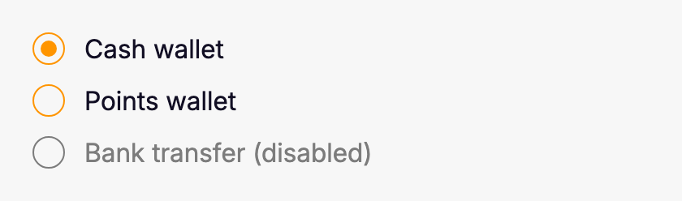
  </picture>
</p>

<p align="center">
  <a href="https://snack.expo.dev/?name=%40crownone%2Fui%20%E2%80%94%20StyledRadioButton&description=Interactive%20playground%20for%20%40crownone%2Fui&files=%7B%22App.js%22%3A%7B%22type%22%3A%22CODE%22%2C%22url%22%3A%22https%3A%2F%2Fraw.githubusercontent.com%2Fhammadev%2Fcrownone-ui%2Fmain%2Fexamples%2FPlayground.js%22%7D%2C%22focus.js%22%3A%7B%22type%22%3A%22CODE%22%2C%22contents%22%3A%22export%20default%20%27StyledRadioButton%27%3B%5Cn%22%7D%7D&dependencies=%40crownone%2Fui,expo-font,expo-blur,expo-image,expo-linear-gradient,react-native-reanimated,react-native-safe-area-context,react-native-size-matters,%40expo%2Fvector-icons">
    
  </a>
</p>

```tsx
import { StyledRadioButton, StyledText } from '@crownone/ui';

type Method = 'cash' | 'points';
const [method, setMethod] = useState<Method>('cash');

<Pressable onPress={() => setMethod('cash')} style={{ flexDirection: 'row', gap: 12 }}>
  <StyledRadioButton isSelected={method === 'cash'} />
  <StyledText p>Cash wallet</StyledText>
</Pressable>

<Pressable onPress={() => setMethod('points')} style={{ flexDirection: 'row', gap: 12 }}>
  <StyledRadioButton isSelected={method === 'points'} />
  <StyledText p>Points wallet</StyledText>
</Pressable>

// Disabled
<StyledRadioButton isSelected={false} isDisabled />
```

| Prop | Type | Default | Description |
|---|---|---|---|
| `isSelected` | `boolean` | **required** | Whether this option is selected |
| `isDisabled` | `boolean` | `false` | Muted, disabled style |

---

### StyledChip

A tag or badge with color variants, two sizes and optional press behavior. Use it for statuses, filters and labels.

<p align="center">
  <picture>
    <source media="(prefers-color-scheme: dark)" srcset="https://raw.githubusercontent.com/hammadev/crownone-ui/main/docs/images/chip-dark.png">
    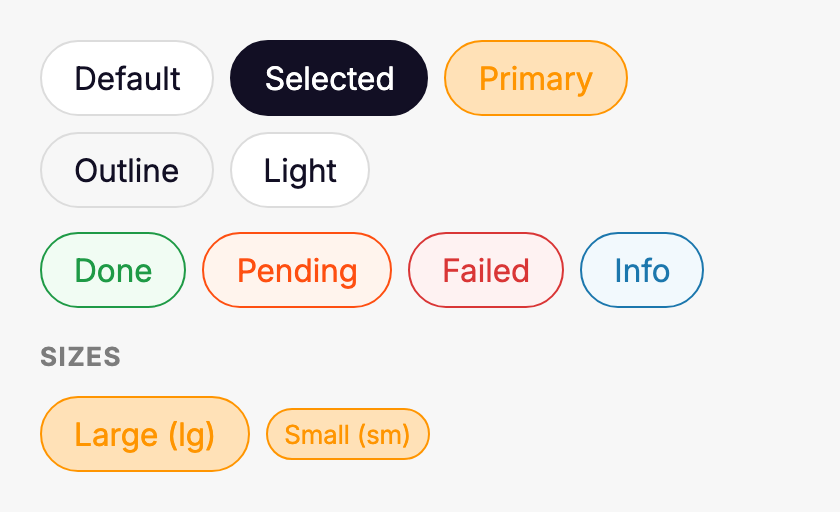
  </picture>
</p>

<p align="center">
  <a href="https://snack.expo.dev/?name=%40crownone%2Fui%20%E2%80%94%20StyledChip&description=Interactive%20playground%20for%20%40crownone%2Fui&files=%7B%22App.js%22%3A%7B%22type%22%3A%22CODE%22%2C%22url%22%3A%22https%3A%2F%2Fraw.githubusercontent.com%2Fhammadev%2Fcrownone-ui%2Fmain%2Fexamples%2FPlayground.js%22%7D%2C%22focus.js%22%3A%7B%22type%22%3A%22CODE%22%2C%22contents%22%3A%22export%20default%20%27StyledChip%27%3B%5Cn%22%7D%7D&dependencies=%40crownone%2Fui,expo-font,expo-blur,expo-image,expo-linear-gradient,react-native-reanimated,react-native-safe-area-context,react-native-size-matters,%40expo%2Fvector-icons">
    
  </a>
</p>

```tsx
import { StyledChip } from '@crownone/ui';

// Neutral
<StyledChip label="Default" variant="default" />
<StyledChip label="Selected" selected />
<StyledChip label="Primary" variant="primary" />
<StyledChip label="Outline" variant="outline" />
<StyledChip label="Light"   variant="light" />

// Status
<StyledChip label="Done"    variant="success" />
<StyledChip label="Pending" variant="warning" />
<StyledChip label="Failed"  variant="danger" />
<StyledChip label="Info"    variant="info" />

// Sizes
<StyledChip label="Large (lg)" variant="primary" size="lg" />
<StyledChip label="Small (sm)" variant="primary" size="sm" />

// Pressable filter
<StyledChip label="Active" selected={filter === 'active'} onPress={() => setFilter('active')} />
```

| Prop | Type | Default | Description |
|---|---|---|---|
| `label` | `string` | **required** | Chip text |
| `variant` | `StyledChipVariant` | `"default"` | `default` · `selected` · `primary` · `outline` · `light` · `success` · `warning` · `danger` · `info` |
| `selected` | `boolean` | — | Forces the `selected` style |
| `size` | `"sm" \| "lg"` | `"lg"` | Controls the padding |
| `onPress` | `() => void` | — | Makes the chip pressable |
| `chipStyle` | `StyleProp<ViewStyle>` | — | Container style |
| `textStyle` | `StyleProp<TextStyle>` | — | Label style |

---

### StyledIcon

A wrapper around [`MaterialCommunityIcons`](https://pictogrammers.com/library/mdi/). It uses the theme's icon color unless you pass `color`.

<p align="center">
  <picture>
    <source media="(prefers-color-scheme: dark)" srcset="https://raw.githubusercontent.com/hammadev/crownone-ui/main/docs/images/icon-dark.png">
    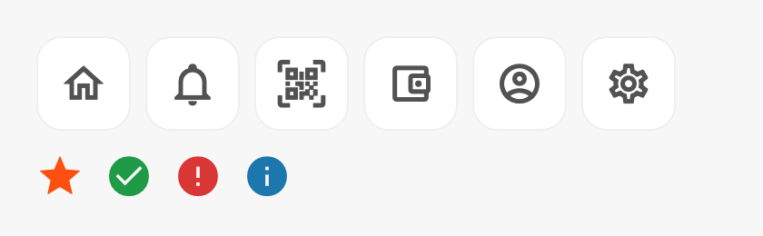
  </picture>
</p>

<p align="center">
  <a href="https://snack.expo.dev/?name=%40crownone%2Fui%20%E2%80%94%20StyledIcon&description=Interactive%20playground%20for%20%40crownone%2Fui&files=%7B%22App.js%22%3A%7B%22type%22%3A%22CODE%22%2C%22url%22%3A%22https%3A%2F%2Fraw.githubusercontent.com%2Fhammadev%2Fcrownone-ui%2Fmain%2Fexamples%2FPlayground.js%22%7D%2C%22focus.js%22%3A%7B%22type%22%3A%22CODE%22%2C%22contents%22%3A%22export%20default%20%27StyledIcon%27%3B%5Cn%22%7D%7D&dependencies=%40crownone%2Fui,expo-font,expo-blur,expo-image,expo-linear-gradient,react-native-reanimated,react-native-safe-area-context,react-native-size-matters,%40expo%2Fvector-icons">
    
  </a>
</p>

```tsx
import { StyledIcon, useTheme } from '@crownone/ui';

const theme = useTheme();

// Theme icon color
<StyledIcon name="home-outline" size={26} />
<StyledIcon name="bell-outline" size={26} />
<StyledIcon name="qrcode-scan" size={26} />

// Semantic colors
<StyledIcon name="star"          size={26} color={theme.colors.warning} />
<StyledIcon name="check-circle"  size={26} color={theme.colors.success} />
<StyledIcon name="alert-circle"  size={26} color={theme.colors.danger} />
<StyledIcon name="information"   size={26} color={theme.colors.info} />
```

| Prop | Type | Default | Description |
|---|---|---|---|
| `name` | `string` | **required** | Icon name from the [MDI library](https://pictogrammers.com/library/mdi/) |
| `size` | `number` | **required** | Icon size in dp |
| `color` | `string` | `theme.colors.icon` | Icon color |
| `style` | `StyleProp<TextStyle>` | — | Additional styles |

---

### StyledTextField

A text input with a label, a left icon slot, a password visibility toggle and inline `react-hook-form` errors.

<p align="center">
  <picture>
    <source media="(prefers-color-scheme: dark)" srcset="https://raw.githubusercontent.com/hammadev/crownone-ui/main/docs/images/textfield-dark.png">
    
  </picture>
</p>

<p align="center">
  <a href="https://snack.expo.dev/?name=%40crownone%2Fui%20%E2%80%94%20StyledTextField&description=Interactive%20playground%20for%20%40crownone%2Fui&files=%7B%22App.js%22%3A%7B%22type%22%3A%22CODE%22%2C%22url%22%3A%22https%3A%2F%2Fraw.githubusercontent.com%2Fhammadev%2Fcrownone-ui%2Fmain%2Fexamples%2FPlayground.js%22%7D%2C%22focus.js%22%3A%7B%22type%22%3A%22CODE%22%2C%22contents%22%3A%22export%20default%20%27StyledTextField%27%3B%5Cn%22%7D%7D&dependencies=%40crownone%2Fui,expo-font,expo-blur,expo-image,expo-linear-gradient,react-native-reanimated,react-native-safe-area-context,react-native-size-matters,%40expo%2Fvector-icons">
    
  </a>
</p>

```tsx
import { StyledIcon, StyledTextField } from '@crownone/ui';

// Basic
<StyledTextField label="Full name" placeholder="Enter your name" text={name} setText={setName} />

// Icon + react-hook-form error
<StyledTextField
  label="Email"
  text={email}
  setText={setEmail}
  icon={<StyledIcon name="email-outline" size={20} />}
  formKey="email"
  errors={errors} // from useForm(), or { email: 'Enter a valid email address' }
/>

// Password with visibility toggle
<StyledTextField
  label="Password"
  text={password}
  setText={setPassword}
  secureTextEntry
  withPasswordToggle
/>

// Disabled
<StyledTextField label="Account ID" text={accountId} setText={setAccountId} disabled />
```

| Prop | Type | Default | Description |
|---|---|---|---|
| `text` / `value` | `string` | — | Controlled value |
| `setText` | `Dispatch<SetStateAction<string>> \| (value: string) => void` | — | State setter (or use `onChangeText`) |
| `label` | `string` | — | Label above the input |
| `placeholder` | `string` | `""` | Placeholder text |
| `icon` | `ReactElement` | — | Element on the left side of the input |
| `formKey` | `string` | `""` | Key to look up in `errors` |
| `errors` | `FormErrors` | `{}` | `react-hook-form` `formState.errors`, or `{ [formKey]: message }` |
| `withPasswordToggle` | `boolean` | `false` | Shows an eye toggle when `secureTextEntry` is set |
| `disabled` | `boolean` | `false` | Non-editable, muted background |
| `marginVertical` | `number` | `0` | Vertical spacing |
| `containerStyle` | `StyleProp<ViewStyle>` | — | Outer container style |
| `inputStyle` | `StyleProp<TextStyle>` | — | `TextInput` style |

All React Native `TextInput` props are also accepted.

---

### StyledDropdown

A cross-platform select. It opens a native `ActionSheetIOS` on iOS and a modal list on Android and Web.

<p align="center">
  <picture>
    <source media="(prefers-color-scheme: dark)" srcset="https://raw.githubusercontent.com/hammadev/crownone-ui/main/docs/images/dropdown-dark.png">
    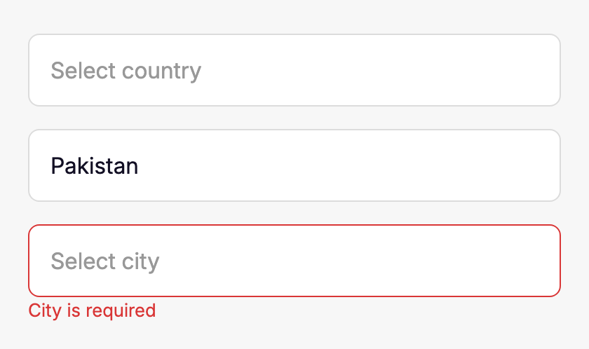
  </picture>
</p>

<p align="center">
  <a href="https://snack.expo.dev/?name=%40crownone%2Fui%20%E2%80%94%20StyledDropdown&description=Interactive%20playground%20for%20%40crownone%2Fui&files=%7B%22App.js%22%3A%7B%22type%22%3A%22CODE%22%2C%22url%22%3A%22https%3A%2F%2Fraw.githubusercontent.com%2Fhammadev%2Fcrownone-ui%2Fmain%2Fexamples%2FPlayground.js%22%7D%2C%22focus.js%22%3A%7B%22type%22%3A%22CODE%22%2C%22contents%22%3A%22export%20default%20%27StyledDropdown%27%3B%5Cn%22%7D%7D&dependencies=%40crownone%2Fui,expo-font,expo-blur,expo-image,expo-linear-gradient,react-native-reanimated,react-native-safe-area-context,react-native-size-matters,%40expo%2Fvector-icons">
    
  </a>
</p>

```tsx
import { StyledDropdown } from '@crownone/ui';
import type { DropdownItem } from '@crownone/ui';

const countries: DropdownItem<string>[] = [
  { label: 'Pakistan',             value: 'PK' },
  { label: 'United Arab Emirates', value: 'AE' },
  { label: 'United Kingdom',       value: 'GB' },
];

// Placeholder
<StyledDropdown items={countries} value={null} onChange={setCountry}
  placeholder="Select country" formKey="country" errors={errors} />

// Selected
<StyledDropdown items={countries} value="PK" onChange={setCountry}
  formKey="country" errors={errors} />

// Error
<StyledDropdown items={cities} value={null} onChange={setCity}
  placeholder="Select city" formKey="city" errors={errors} errorText="City is required" />
```

**With `react-hook-form`:**

```tsx
<Controller
  control={control}
  name="country"
  render={({ field: { value, onChange } }) => (
    <StyledDropdown
      items={countries}
      value={value}
      onChange={onChange}
      placeholder="Select country"
      formKey="country"
      errors={errors}
    />
  )}
/>
```

| Prop | Type | Default | Description |
|---|---|---|---|
| `items` | `DropdownItem<T>[]` | **required** | `{ label, value, disabled? }` |
| `value` | `T \| null \| undefined` | **required** | Selected value |
| `onChange` | `(value: T) => void` | **required** | Called on selection |
| `formKey` | `string` | — | Key to look up in `errors` |
| `errors` | `FormErrors` | — | `react-hook-form` `formState.errors`, or `{ [formKey]: message }` |
| `label` | `string` | — | Label above the field |
| `placeholder` | `string` | `strings.selectPlaceholder` ("Select…") | Shown when nothing is selected |
| `errorText` | `string` | — | Explicit error message below the input |
| `disabled` | `boolean` | `false` | Prevents opening |
| `inputStyle` | `StyleProp<ViewStyle>` | — | Style for the input box |
| `rightAdornment` | `ReactNode` | — | Element on the right side of the input |

---

### StyledTabs

A segmented tab bar with optional count badges.

<p align="center">
  <picture>
    <source media="(prefers-color-scheme: dark)" srcset="https://raw.githubusercontent.com/hammadev/crownone-ui/main/docs/images/tabs-dark.png">
    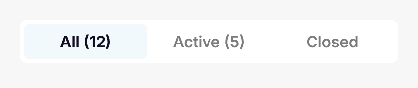
  </picture>
</p>

<p align="center">
  <a href="https://snack.expo.dev/?name=%40crownone%2Fui%20%E2%80%94%20StyledTabs&description=Interactive%20playground%20for%20%40crownone%2Fui&files=%7B%22App.js%22%3A%7B%22type%22%3A%22CODE%22%2C%22url%22%3A%22https%3A%2F%2Fraw.githubusercontent.com%2Fhammadev%2Fcrownone-ui%2Fmain%2Fexamples%2FPlayground.js%22%7D%2C%22focus.js%22%3A%7B%22type%22%3A%22CODE%22%2C%22contents%22%3A%22export%20default%20%27StyledTabs%27%3B%5Cn%22%7D%7D&dependencies=%40crownone%2Fui,expo-font,expo-blur,expo-image,expo-linear-gradient,react-native-reanimated,react-native-safe-area-context,react-native-size-matters,%40expo%2Fvector-icons">
    
  </a>
</p>

```tsx
import { StyledTabs } from '@crownone/ui';
import type { TabItem } from '@crownone/ui';

type TabKey = 'all' | 'active' | 'closed';

const tabs: TabItem<TabKey>[] = [
  { key: 'all',    label: 'All',    badge: 12 },
  { key: 'active', label: 'Active', badge: 5 },
  { key: 'closed', label: 'Closed' },
];

const [activeTab, setActiveTab] = useState<TabKey>('all');

<StyledTabs tabs={tabs} activeKey={activeTab} onTabChange={setActiveTab} />
```

| Prop | Type | Default | Description |
|---|---|---|---|
| `tabs` | `TabItem<Key>[]` | **required** | `{ key, label, badge? }` |
| `activeKey` | `Key` | **required** | Currently active tab |
| `onTabChange` | `(key: Key) => void` | **required** | Called when a tab is pressed |
| `style` | `StyleProp<ViewStyle>` | — | Container style |
| `tabStyle` | `StyleProp<ViewStyle>` | — | Style for every tab |
| `activeTabStyle` | `StyleProp<ViewStyle>` | — | Style for the active tab |
| `textStyle` | `StyleProp<TextStyle>` | — | Tab label style |
| `activeTextStyle` | `StyleProp<TextStyle>` | — | Active tab label style |

---

### StatusCard

An inline alert banner with an icon, an optional title, a message and a description. It can also be pressable.

<p align="center">
  <picture>
    <source media="(prefers-color-scheme: dark)" srcset="https://raw.githubusercontent.com/hammadev/crownone-ui/main/docs/images/statuscard-dark.png">
    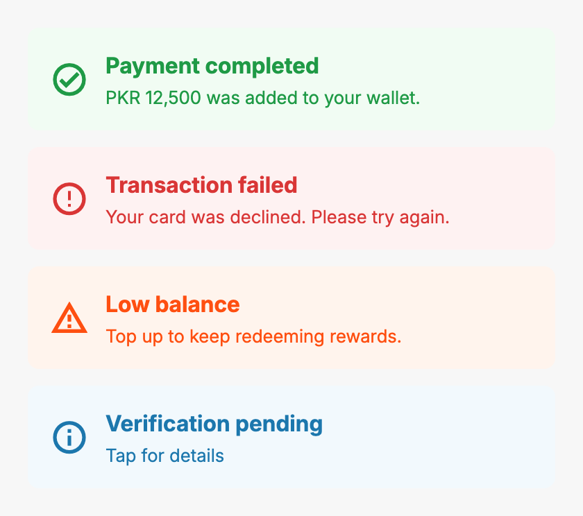
  </picture>
</p>

<p align="center">
  <a href="https://snack.expo.dev/?name=%40crownone%2Fui%20%E2%80%94%20StatusCard&description=Interactive%20playground%20for%20%40crownone%2Fui&files=%7B%22App.js%22%3A%7B%22type%22%3A%22CODE%22%2C%22url%22%3A%22https%3A%2F%2Fraw.githubusercontent.com%2Fhammadev%2Fcrownone-ui%2Fmain%2Fexamples%2FPlayground.js%22%7D%2C%22focus.js%22%3A%7B%22type%22%3A%22CODE%22%2C%22contents%22%3A%22export%20default%20%27StatusCard%27%3B%5Cn%22%7D%7D&dependencies=%40crownone%2Fui,expo-font,expo-blur,expo-image,expo-linear-gradient,react-native-reanimated,react-native-safe-area-context,react-native-size-matters,%40expo%2Fvector-icons">
    
  </a>
</p>

```tsx
import { StatusCard } from '@crownone/ui';

<StatusCard variant="success" message="Payment completed"
  description="PKR 12,500 was added to your wallet." />

<StatusCard variant="error" message="Transaction failed"
  description="Your card was declined. Please try again." />

<StatusCard variant="warning" message="Low balance"
  description="Top up to keep redeeming rewards." />

// Clickable, with a hint line
<StatusCard variant="info" message="Verification pending"
  clickable hintText="Tap for details" onPress={() => router.push('/kyc')} />

// Custom title and icon
<StatusCard variant="warning" title="Offline" iconName="wifi-off"
  message="No internet connection." />
```

| Prop | Type | Default | Description |
|---|---|---|---|
| `variant` | `StatusCardVariant` | `"error"` | `error` · `warning` · `info` · `success` |
| `message` | `string` | — | Main message |
| `description` | `string` | — | Supporting text |
| `title` | `string` | — | Small uppercase label above the message |
| `iconName` | `string` | variant default | MaterialCommunityIcons name |
| `clickable` | `boolean` | `false` | Renders as a pressable card |
| `onPress` | `(e) => void` | — | Press handler when `clickable` |
| `hintText` | `string` | `"Tap to check details."` | Hint shown when `clickable` |
| `style` | `StyleProp<ViewStyle>` | — | Additional styles |

---

### AlphabetAvatar

A circular avatar showing the first letter of a name. The background color is derived from the letter, so the same name always gets the same color.

<p align="center">
  <picture>
    <source media="(prefers-color-scheme: dark)" srcset="https://raw.githubusercontent.com/hammadev/crownone-ui/main/docs/images/avatar-dark.png">
    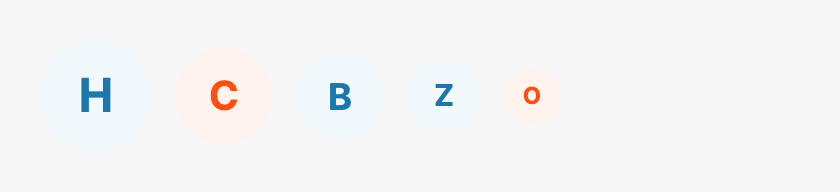
  </picture>
</p>

<p align="center">
  <a href="https://snack.expo.dev/?name=%40crownone%2Fui%20%E2%80%94%20AlphabetAvatar&description=Interactive%20playground%20for%20%40crownone%2Fui&files=%7B%22App.js%22%3A%7B%22type%22%3A%22CODE%22%2C%22url%22%3A%22https%3A%2F%2Fraw.githubusercontent.com%2Fhammadev%2Fcrownone-ui%2Fmain%2Fexamples%2FPlayground.js%22%7D%2C%22focus.js%22%3A%7B%22type%22%3A%22CODE%22%2C%22contents%22%3A%22export%20default%20%27AlphabetAvatar%27%3B%5Cn%22%7D%7D&dependencies=%40crownone%2Fui,expo-font,expo-blur,expo-image,expo-linear-gradient,react-native-reanimated,react-native-safe-area-context,react-native-size-matters,%40expo%2Fvector-icons">
    
  </a>
</p>

```tsx
import { AlphabetAvatar } from '@crownone/ui';

<AlphabetAvatar name="Hammad Anwar" size={56} />
<AlphabetAvatar name="Crown One"    size={48} />
<AlphabetAvatar name="Bilal"        size={44} />
<AlphabetAvatar name="Zara"         size={36} />
<AlphabetAvatar name="Owais"        size={28} />
```

| Prop | Type | Default | Description |
|---|---|---|---|
| `name` | `string` | **required** | Source of the letter and color |
| `size` | `number` | `44` | Diameter in dp |
| `style` | `StyleProp<ViewStyle>` | — | Outer style |

---

### LoadingComponent

A thin wrapper around `ActivityIndicator` that renders only while `loading` is `true`.

<p align="center">
  <picture>
    <source media="(prefers-color-scheme: dark)" srcset="https://raw.githubusercontent.com/hammadev/crownone-ui/main/docs/images/loading-dark.png">
    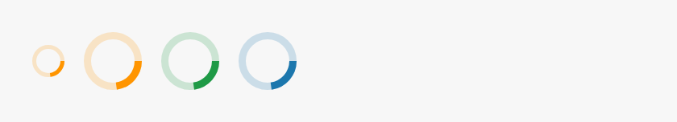
  </picture>
</p>

<p align="center">
  <a href="https://snack.expo.dev/?name=%40crownone%2Fui%20%E2%80%94%20LoadingComponent&description=Interactive%20playground%20for%20%40crownone%2Fui&files=%7B%22App.js%22%3A%7B%22type%22%3A%22CODE%22%2C%22url%22%3A%22https%3A%2F%2Fraw.githubusercontent.com%2Fhammadev%2Fcrownone-ui%2Fmain%2Fexamples%2FPlayground.js%22%7D%2C%22focus.js%22%3A%7B%22type%22%3A%22CODE%22%2C%22contents%22%3A%22export%20default%20%27LoadingComponent%27%3B%5Cn%22%7D%7D&dependencies=%40crownone%2Fui,expo-font,expo-blur,expo-image,expo-linear-gradient,react-native-reanimated,react-native-safe-area-context,react-native-size-matters,%40expo%2Fvector-icons">
    
  </a>
</p>

```tsx
import { LoadingComponent, useTheme } from '@crownone/ui';

const theme = useTheme();

<LoadingComponent loading={isFetching} size="small" color={theme.colors.primary} />
<LoadingComponent loading={isFetching} size="large" color={theme.colors.primary} />
<LoadingComponent loading={isFetching} size="large" color={theme.colors.success} />
```

| Prop | Type | Default | Description |
|---|---|---|---|
| `loading` | `boolean` | `false` | Renders nothing when `false` |
| `size` | `"small" \| "large"` | **required** | Spinner size |
| `color` | `string` | `theme.colors.textInverse` | Spinner color |
| `style` | `StyleProp<ViewStyle>` | — | Additional styles |

> The default color is `textInverse`, which is meant for spinners on colored surfaces such as buttons. On a plain background, pass `color` explicitly.

---

### FieldError

A validation message for a form field. Renders nothing when `message` is empty.

<p align="center">
  <picture>
    <source media="(prefers-color-scheme: dark)" srcset="https://raw.githubusercontent.com/hammadev/crownone-ui/main/docs/images/fielderror-dark.png">
    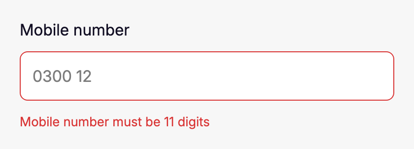
  </picture>
</p>

<p align="center">
  <a href="https://snack.expo.dev/?name=%40crownone%2Fui%20%E2%80%94%20FieldError&description=Interactive%20playground%20for%20%40crownone%2Fui&files=%7B%22App.js%22%3A%7B%22type%22%3A%22CODE%22%2C%22url%22%3A%22https%3A%2F%2Fraw.githubusercontent.com%2Fhammadev%2Fcrownone-ui%2Fmain%2Fexamples%2FPlayground.js%22%7D%2C%22focus.js%22%3A%7B%22type%22%3A%22CODE%22%2C%22contents%22%3A%22export%20default%20%27FieldError%27%3B%5Cn%22%7D%7D&dependencies=%40crownone%2Fui,expo-font,expo-blur,expo-image,expo-linear-gradient,react-native-reanimated,react-native-safe-area-context,react-native-size-matters,%40expo%2Fvector-icons">
    
  </a>
</p>

```tsx
import { FieldError } from '@crownone/ui';

<FieldError message={errors.mobile?.message} />
// e.g. "Mobile number must be 11 digits"
```

| Prop | Type | Default | Description |
|---|---|---|---|
| `message` | `string` | — | Error text; nothing is rendered when it's falsy |

---

### OrDivider

A horizontal rule with a centered label. It's commonly used to separate alternative actions.

<p align="center">
  <picture>
    <source media="(prefers-color-scheme: dark)" srcset="https://raw.githubusercontent.com/hammadev/crownone-ui/main/docs/images/ordivider-dark.png">
    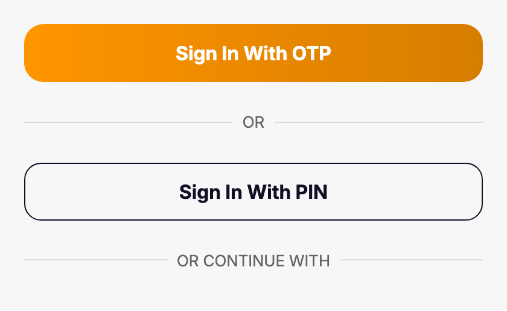
  </picture>
</p>

<p align="center">
  <a href="https://snack.expo.dev/?name=%40crownone%2Fui%20%E2%80%94%20OrDivider&description=Interactive%20playground%20for%20%40crownone%2Fui&files=%7B%22App.js%22%3A%7B%22type%22%3A%22CODE%22%2C%22url%22%3A%22https%3A%2F%2Fraw.githubusercontent.com%2Fhammadev%2Fcrownone-ui%2Fmain%2Fexamples%2FPlayground.js%22%7D%2C%22focus.js%22%3A%7B%22type%22%3A%22CODE%22%2C%22contents%22%3A%22export%20default%20%27OrDivider%27%3B%5Cn%22%7D%7D&dependencies=%40crownone%2Fui,expo-font,expo-blur,expo-image,expo-linear-gradient,react-native-reanimated,react-native-safe-area-context,react-native-size-matters,%40expo%2Fvector-icons">
    
  </a>
</p>

```tsx
import { OrDivider, StyledButton } from '@crownone/ui';

<StyledButton title="Sign in with OTP" onPress={fn} />
<OrDivider />
<StyledButton title="Sign in with PIN" variant="outline" onPress={fn} />
<OrDivider label="OR CONTINUE WITH" />
```

| Prop | Type | Default | Description |
|---|---|---|---|
| `label` | `string` | `strings.or` ("OR") | Centered text |

---

### Skeleton

A pulsing placeholder for loading states. Give it a shape and a background color, or wrap other content in it.

<p align="center">
  <picture>
    <source media="(prefers-color-scheme: dark)" srcset="https://raw.githubusercontent.com/hammadev/crownone-ui/main/docs/images/skeleton-dark.png">
    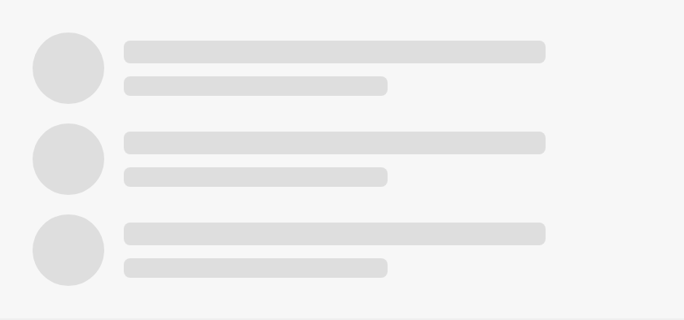
  </picture>
</p>

<p align="center">
  <a href="https://snack.expo.dev/?name=%40crownone%2Fui%20%E2%80%94%20Skeleton&description=Interactive%20playground%20for%20%40crownone%2Fui&files=%7B%22App.js%22%3A%7B%22type%22%3A%22CODE%22%2C%22url%22%3A%22https%3A%2F%2Fraw.githubusercontent.com%2Fhammadev%2Fcrownone-ui%2Fmain%2Fexamples%2FPlayground.js%22%7D%2C%22focus.js%22%3A%7B%22type%22%3A%22CODE%22%2C%22contents%22%3A%22export%20default%20%27Skeleton%27%3B%5Cn%22%7D%7D&dependencies=%40crownone%2Fui,expo-font,expo-blur,expo-image,expo-linear-gradient,react-native-reanimated,react-native-safe-area-context,react-native-size-matters,%40expo%2Fvector-icons">
    
  </a>
</p>

```tsx
import { Skeleton, useTheme } from '@crownone/ui';

function ListItemSkeleton() {
  const { colors } = useTheme();
  const bg = colors.backgroundTertiary;

  return (
    <View style={{ flexDirection: 'row', alignItems: 'center', gap: 12 }}>
      <Skeleton style={{ width: 44, height: 44, borderRadius: 22, backgroundColor: bg }} />
      <View style={{ flex: 1, gap: 8 }}>
        <Skeleton style={{ width: '80%', height: 14, borderRadius: 4, backgroundColor: bg }} />
        <Skeleton style={{ width: '50%', height: 12, borderRadius: 4, backgroundColor: bg }} />
      </View>
    </View>
  );
}

// Slower pulse
<Skeleton duration={1500} style={{ height: 60, borderRadius: 8, backgroundColor: bg }} />
```

| Prop | Type | Default | Description |
|---|---|---|---|
| `style` | `StyleProp<ViewStyle>` | — | Shape, size and background color |
| `duration` | `number` | `1000` | Length of one pulse in ms |
| `children` | `ReactNode` | — | Optional content to pulse |

---

### BottomActionsBar

A blurred action bar that sticks to the bottom of the screen and respects the safe area. It holds the primary actions of a screen.

<p align="center">
  <picture>
    <source media="(prefers-color-scheme: dark)" srcset="https://raw.githubusercontent.com/hammadev/crownone-ui/main/docs/images/bottomactionsbar-dark.png">
    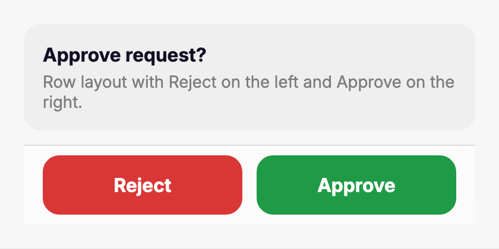
  </picture>
</p>

<p align="center">
  <a href="https://snack.expo.dev/?name=%40crownone%2Fui%20%E2%80%94%20BottomActionsBar&description=Interactive%20playground%20for%20%40crownone%2Fui&files=%7B%22App.js%22%3A%7B%22type%22%3A%22CODE%22%2C%22url%22%3A%22https%3A%2F%2Fraw.githubusercontent.com%2Fhammadev%2Fcrownone-ui%2Fmain%2Fexamples%2FPlayground.js%22%7D%2C%22focus.js%22%3A%7B%22type%22%3A%22CODE%22%2C%22contents%22%3A%22export%20default%20%27BottomActionsBar%27%3B%5Cn%22%7D%7D&dependencies=%40crownone%2Fui,expo-font,expo-blur,expo-image,expo-linear-gradient,react-native-reanimated,react-native-safe-area-context,react-native-size-matters,%40expo%2Fvector-icons">
    
  </a>
</p>

```tsx
import { BottomActionsBar, StyledButton } from '@crownone/ui';

// Reject / Approve pair: Reject (danger) left, Approve (success) right
<BottomActionsBar layout="row" gap={12}>
  <StyledButton title="Reject"  variant="danger"  onPress={reject}  containerStyle={{ flex: 1 }} />
  <StyledButton title="Approve" variant="success" onPress={approve} containerStyle={{ flex: 1 }} />
</BottomActionsBar>

// Stacked
<BottomActionsBar layout="column" align="stretch">
  <StyledButton title="Primary action" onPress={fn} />
  <StyledButton title="Secondary action" variant="light" onPress={fn} />
</BottomActionsBar>

// Inline (not sticky), e.g. at the end of a ScrollView
<BottomActionsBar sticky={false}>
  <StyledButton title="Submit" onPress={fn} containerStyle={{ flex: 1 }} />
</BottomActionsBar>

// Measure the bar to pad the scroll content behind it
const [barHeight, setBarHeight] = useState(0);
<ScrollView contentContainerStyle={{ paddingBottom: barHeight }}>{/* … */}</ScrollView>
<BottomActionsBar onHeight={setBarHeight}>{/* … */}</BottomActionsBar>
```

| Prop | Type | Default | Description |
|---|---|---|---|
| `children` | `ReactNode` | **required** | Actions or content |
| `layout` | `"row" \| "column"` | `"row"` | Flex direction |
| `gap` | `number` | `10` | Space between children |
| `align` | `"flex-start" \| "center" \| "flex-end" \| "stretch"` | `"center"` | `alignItems` |
| `justify` | `"flex-start" \| "center" \| "flex-end" \| "space-between" \| "space-around"` | `"center"` | `justifyContent` |
| `sticky` | `boolean` | `true` | Pins the bar to the bottom of the screen |
| `respectSafeArea` | `boolean` | `true` | Adds the bottom safe-area inset |
| `showTopEdge` | `boolean` | `true` | Hairline border on top |
| `intensity` | `number` | `50` | Blur intensity |
| `horizontalPadding` | `number` | `16` | Horizontal padding |
| `verticalPadding` | `number` | `8` | Top padding |
| `onHeight` | `(h: number) => void` | — | Reports the measured height |
| `style` | `StyleProp<ViewStyle>` | — | Outer style |
| `contentStyle` | `StyleProp<ViewStyle>` | — | Inner content style |

---

### BlurModalBackdrop

A full-screen blurred backdrop for modals and overlays. Taps on the backdrop call `onPress`. Taps on the content don't.

<p align="center">
  <picture>
    <source media="(prefers-color-scheme: dark)" srcset="https://raw.githubusercontent.com/hammadev/crownone-ui/main/docs/images/blurmodalbackdrop-dark.png">
    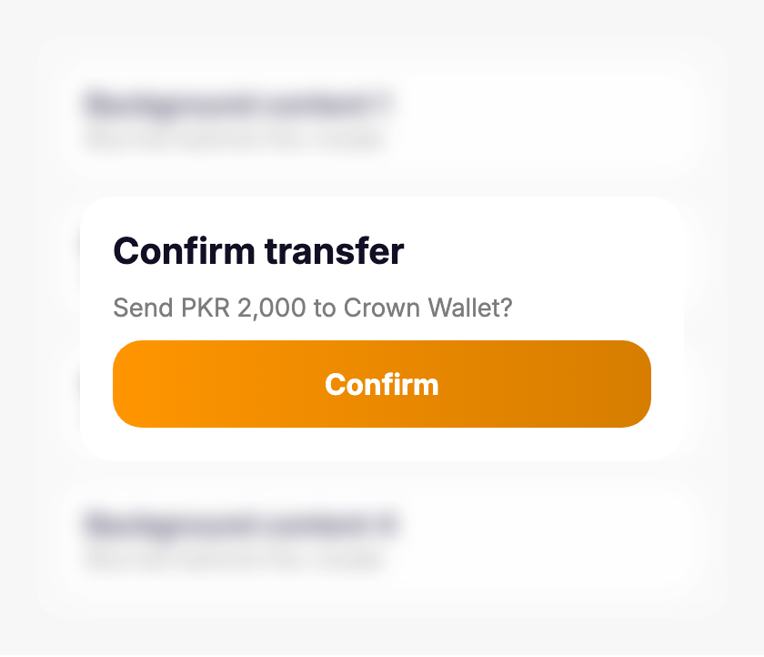
  </picture>
</p>

<p align="center">
  <a href="https://snack.expo.dev/?name=%40crownone%2Fui%20%E2%80%94%20BlurModalBackdrop&description=Interactive%20playground%20for%20%40crownone%2Fui&files=%7B%22App.js%22%3A%7B%22type%22%3A%22CODE%22%2C%22url%22%3A%22https%3A%2F%2Fraw.githubusercontent.com%2Fhammadev%2Fcrownone-ui%2Fmain%2Fexamples%2FPlayground.js%22%7D%2C%22focus.js%22%3A%7B%22type%22%3A%22CODE%22%2C%22contents%22%3A%22export%20default%20%27BlurModalBackdrop%27%3B%5Cn%22%7D%7D&dependencies=%40crownone%2Fui,expo-font,expo-blur,expo-image,expo-linear-gradient,react-native-reanimated,react-native-safe-area-context,react-native-size-matters,%40expo%2Fvector-icons">
    
  </a>
</p>

```tsx
import { BlurModalBackdrop, StyledButton, StyledText, useTheme } from '@crownone/ui';
import { Modal, View } from 'react-native';

const theme = useTheme();

<Modal visible={visible} transparent animationType="fade" onRequestClose={close}>
  <BlurModalBackdrop onPress={close} contentStyle={{ justifyContent: 'center', padding: 24 }}>
    <View style={{ backgroundColor: theme.colors.surface, borderRadius: 18, padding: 18, gap: 10 }}>
      <StyledText h6>Confirm transfer</StyledText>
      <StyledText small textColor="textMuted">Send PKR 2,000 to Crown Wallet?</StyledText>
      <StyledButton title="Confirm" onPress={confirm} />
    </View>
  </BlurModalBackdrop>
</Modal>
```

| Prop | Type | Default | Description |
|---|---|---|---|
| `children` | `ReactNode` | **required** | Modal content (taps on it don't dismiss) |
| `onPress` | `() => void` | — | Called when the backdrop is tapped |
| `contentStyle` | `StyleProp<ViewStyle>` | — | Style for the content wrapper |

---

### SearchBar

A search input with a magnifier icon, built on `StyledTextField`.

<p align="center">
  <picture>
    <source media="(prefers-color-scheme: dark)" srcset="https://raw.githubusercontent.com/hammadev/crownone-ui/main/docs/images/searchbar-dark.png">
    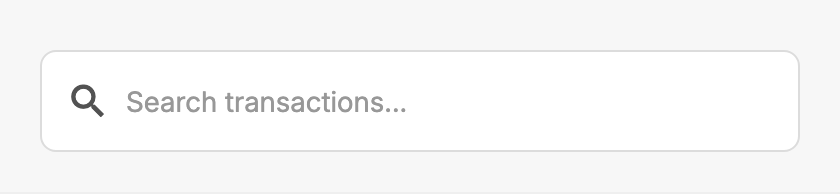
  </picture>
</p>

<p align="center">
  <a href="https://snack.expo.dev/?name=%40crownone%2Fui%20%E2%80%94%20SearchBar&description=Interactive%20playground%20for%20%40crownone%2Fui&files=%7B%22App.js%22%3A%7B%22type%22%3A%22CODE%22%2C%22url%22%3A%22https%3A%2F%2Fraw.githubusercontent.com%2Fhammadev%2Fcrownone-ui%2Fmain%2Fexamples%2FPlayground.js%22%7D%2C%22focus.js%22%3A%7B%22type%22%3A%22CODE%22%2C%22contents%22%3A%22export%20default%20%27SearchBar%27%3B%5Cn%22%7D%7D&dependencies=%40crownone%2Fui,expo-font,expo-blur,expo-image,expo-linear-gradient,react-native-reanimated,react-native-safe-area-context,react-native-size-matters,%40expo%2Fvector-icons">
    
  </a>
</p>

```tsx
import { SearchBar } from '@crownone/ui';

const [query, setQuery] = useState('');

<SearchBar value={query} setValue={setQuery} placeholder="Search transactions..." />

// React to changes (e.g. a debounced fetch)
<SearchBar value={query} setValue={setQuery} onChangeText={(text) => search(text)} />
```

| Prop | Type | Default | Description |
|---|---|---|---|
| `value` | `string` | **required** | Controlled value |
| `setValue` | `Dispatch<SetStateAction<string>>` | **required** | State setter |
| `onChangeText` | `(value: string) => void` | — | Called after every change |
| `placeholder` | `string` | — | Placeholder text |
| `containerStyle` | `StyleProp<ViewStyle>` | — | Outer container style |
| `inputStyle` | `StyleProp<TextStyle>` | — | `TextInput` style |

All React Native `TextInput` props are also accepted.

---

### EmptyListComponent

The standard "No record found" message for empty lists. Use it instead of building an info `StatusCard` by hand.

```tsx
import { EmptyListComponent } from '@crownone/ui';

<FlatList
  data={orders}
  renderItem={renderOrder}
  ListEmptyComponent={<EmptyListComponent isLoading={isLoading} />}
/>

// Custom message
<EmptyListComponent message="No pending requests" />
```

| Prop | Type | Default | Description |
|---|---|---|---|
| `message` | `string` | `strings.noRecordFound` | Text to show |
| `isLoading` | `boolean` | `false` | Renders nothing while `true`, so the message doesn't flash during a fetch |
| `style` | `StyleProp<ViewStyle>` | — | No built-in margin: add `marginHorizontal` when the parent has no padding |

---

### SummaryValueCard

A small tinted card with a title and a value, for totals and balances.

```tsx
import { SummaryValueCard, formatCashWallet } from '@crownone/ui';

<View style={{ flexDirection: 'row', gap: 10 }}>
  <SummaryValueCard title="Old cash wallet" value={formatCashWallet(12500)} variant="info" />
  <SummaryValueCard title="New cash wallet" value={formatCashWallet(17500)} variant="success" />
</View>
```

| Prop | Type | Default | Description |
|---|---|---|---|
| `title` | `string` | **required** | Label above the value |
| `value` | `string` | **required** | The value, already formatted |
| `variant` | `'sent' \| 'received' \| 'success' \| 'warning' \| 'danger' \| 'info'` | **required** | Color scheme |
| `style` | `StyleProp<ViewStyle>` | — | Additional styles |

---

### DateGroupedList

A `SectionList` that groups items by date, with sticky headers showing the date and an item count.

```tsx
import { DateGroupedList } from '@crownone/ui';

<DateGroupedList
  items={transactions}
  getDateKey={(tx) => tx.createdAt}
  keyExtractor={(tx) => String(tx.id)}
  renderItem={({ item }) => <TransactionRow item={item} />}
  refreshing={isFetching}
  onRefresh={refetch}
/>
```

| Prop | Type | Default | Description |
|---|---|---|---|
| `items` | `T[]` | **required** | Items to group |
| `getDateKey` | `(item: T) => string \| number \| null \| undefined` | **required** | Any date-parseable value |
| `keyExtractor` | `(item: T, index: number) => string` | **required** | Item key |
| `renderItem` | `SectionListRenderItem<T>` | **required** | Row renderer |
| `dateFormat` | `string` | `"dddd, DD-MMM-YYYY"` | [dayjs format](https://day.js.org/docs/en/display/format) for headers |
| `loading` / `refreshing` / `onRefresh` | | — | Loading and pull-to-refresh |
| `emptyText` | `string` | `strings.noRecordFound` | Message when there are no items |
| `ListHeaderComponent` / `ListFooterComponent` / `contentContainerStyle` | | — | Passed to the `SectionList` |

---

### AlphabetGroupedList

A `SectionList` that groups items A–Z by the first letter of a name, with sticky letter headers and counts.

```tsx
import { AlphabetGroupedList } from '@crownone/ui';

<AlphabetGroupedList
  items={shops}
  getNameKey={(shop) => shop.name}
  keyExtractor={(shop) => shop.code}
  renderItem={({ item }) => <ShopRow shop={item} />}
/>
```

Props are the same as `DateGroupedList`, with `getNameKey: (item: T) => string | null | undefined` instead of `getDateKey` and no `dateFormat`.

---

## Theming

### Built-in themes

The package ships `lightTheme` and `darkTheme`. `ThemeProvider` picks one based on the `dark` prop, or you can pass a theme of your own.

```tsx
<ThemeProvider dark={colorScheme === 'dark'}>
  <App />
</ThemeProvider>
```

### Theme shape

```ts
type AppTheme = {
  dark: boolean;
  colors: {
    primary, primaryPressed, primarySoft, secondary,
    background, backgroundSecondary, backgroundTertiary,
    surface, surfaceSecondary, card,
    border, borderSoft,
    text, textSecondary, textMuted, textInverse,
    icon, placeholder,
    success, successSoft,
    warning, warningSoft,
    danger,  dangerSoft,
    info,    infoSoft,
    overlay, shadow,
    tabIconDefault, tabIconSelected,
    statusBar,
  };
  spacing: { xs, sm, md, lg, xl, xxl }; // 4, 8, 12, 16, 24, 32
  radius:  { xs, sm, md, lg, xl, pill }; // 6, 10, 14, 18, 24, 999
};
```

### Custom theme

Spread a built-in theme and override only what you need:

```tsx
import { lightTheme, ThemeProvider } from '@crownone/ui';
import type { AppTheme } from '@crownone/ui';

const brandTheme: AppTheme = {
  ...lightTheme,
  colors: {
    ...lightTheme.colors,
    primary: '#6200EE',
    primaryPressed: '#3700B3',
    primarySoft: '#EDE7F6',
  },
};

<ThemeProvider theme={brandTheme}>
  <App />
</ThemeProvider>
```

`theme` takes precedence over `dark`.

### useTheme

Read the active theme anywhere inside the provider:

```tsx
import { StyledText, useTheme } from '@crownone/ui';

function Balance() {
  const theme = useTheme();

  return (
    <View style={{ backgroundColor: theme.colors.surface, borderRadius: theme.radius.md, padding: theme.spacing.lg }}>
      <StyledText textColor={theme.colors.primary}>PKR 12,500</StyledText>
    </View>
  );
}
```

### Other exports

| Export | Description |
|---|---|
| `colors`, `palette` | Raw color tokens behind the themes |
| `fontStyles`, `FONT_FAMILIES` | Typography styles used by `StyledText` |
| `CONTAINER_PADDING`, `RADIUS` | Layout constants used by the components |

### Translations

Components render a few words of their own: the dropdown's "Cancel" and "Select…", "OR", "No record found", the `StatusCard` titles and hint, and the share sheet title. They're English by default. Translate them once through `ThemeProvider`:

```tsx
import { ThemeProvider } from '@crownone/ui';
import { useTranslation } from 'react-i18next';

const { t } = useTranslation();

<ThemeProvider
  dark={isDark}
  strings={{
    cancel: t('CANCEL'),
    or: t('OR'),
    noRecordFound: t('NO_RECORD_FOUND'),
    warningTitle: t('WARNING'),
    successTitle: t('SUCCESS'),
  }}
>
  <App />
</ThemeProvider>
```

Missing keys fall back to English. `defaultStrings` holds the defaults, `UIStrings` is the type, and `useStrings()` reads the active strings.

---

## Utilities

| Export | Description |
|---|---|
| `formatCashWallet(value)` | `"PKR 12,500"`. Never concatenate `PKR` by hand |
| `formatPointsWallet(value)` | `"12,500 PTS"` |
| `useSinglePress(handler, delay = 500)` | Stable press handler that ignores repeat presses within `delay` ms, for your own `Pressable`s |
| `getFieldErrorMessage(errors, key)` | Reads a field's message from `react-hook-form` errors or a `{ key: message }` map |

---

## Optional Entry Points

Some components need native modules that not every app uses. They live in separate entry points, so apps that don't import them don't need those modules.

### `@crownone/ui/receipt`

`ShareableReceipt` renders a fixed-color receipt that can be captured as a PNG, and `useShareReceipt` captures it and opens the share sheet.

```bash
npx expo install react-native-view-shot expo-sharing
```

```tsx
import { ShareableReceipt, useShareReceipt } from '@crownone/ui/receipt';

const { receiptRef, shareReceipt, isSharing } = useShareReceipt();

// Render off-screen; only the captured image is shown to the user.
<View style={{ position: 'absolute', top: 0, left: -2000 }} pointerEvents="none">
  <ShareableReceipt
    ref={receiptRef}
    logo={require('./assets/logo.png')}
    data={{
      title: 'Cash Approval Receipt',
      dateText: '01:45 PM • 13 Jul, 2026',
      idLabel: 'Transaction ID',
      idValue: 'TX-10421',
      fromLabel: 'Approved By',
      from: { name: 'Crown Traders', mobile: '0300 1234567' },
      toLabel: 'Requested By',
      to: { name: 'Ali Motors', mobile: '0321 7654321' },
      amountLabel: 'Amount',
      amountText: formatCashWallet(12500),
      disclaimer: 'This is a system-generated receipt.',
    }}
  />
</View>

<StyledButton title="Share receipt" variant="outline" onPress={shareReceipt} loading={isSharing} />
```

### `@crownone/ui/otp`

`OtpBoxInput`: one box per digit.

```bash
npm install input-otp-native
```

```tsx
import { OtpBoxInput } from '@crownone/ui/otp';

<OtpBoxInput value={otp} onChange={setOtp} /> // maxLength defaults to 6
```

---

## TypeScript

The package ships type definitions. These types are exported for use in your own code:

```ts
import type {
  AppTheme,
  AppColors,
  UIStrings,
  FormErrors,
  DateSection,
  AlphabetSection,
  StyledButtonProps,
  StyledButtonVariant,
  StyledChipVariant,
  StatusCardVariant,
  DropdownItem,
  TabItem,
  SkeletonProps,
} from '@crownone/ui';
```

---

## Peer Dependencies

| Package | Version | Used by |
|---|---|---|
| `react` | `>= 18` | All |
| `react-native` | `>= 0.73` | All |
| `@expo/vector-icons` | `>= 13` | `StyledIcon`, `StyledCheckbox`, `StyledTextField`, `StatusCard` |
| `expo-blur` | `>= 13` | `BottomActionsBar`, `BlurModalBackdrop` |
| `expo-image` | `>= 1` | `StyledImage` (iOS and Android) |
| `expo-linear-gradient` | `>= 13` | `StyledButton` (primary gradient) |
| `react-native-reanimated` | `>= 3` | `Skeleton` |
| `react-native-safe-area-context` | `>= 4` | `BottomActionsBar` |
| `react-native-size-matters` | `>= 0.4` | `AlphabetAvatar` |
| `react-native-view-shot` | `>= 4` | `@crownone/ui/receipt` only (optional) |
| `expo-sharing` | `>= 13` | `@crownone/ui/receipt` only (optional) |
| `input-otp-native` | `>= 0.6` | `@crownone/ui/otp` only (optional) |

`dayjs` (used by `DateGroupedList`) is installed automatically as a regular dependency.

---

## Using with AI Assistants

The package ships docs written for AI coding assistants, matched to the installed version:

| File | What it's for |
|---|---|
| `node_modules/@crownone/ui/llms-full.txt` | Complete usage reference: rules, setup, theme tokens, every component's props and examples |
| `node_modules/@crownone/ui/llms.txt` | Short index in the [llms.txt](https://llmstxt.org) format |
| `node_modules/@crownone/ui/skills/crownone-ui/SKILL.md` | A Claude Code skill for building screens with this library |

**Claude Code:** copy the skill into your app once. It reads `llms-full.txt` from `node_modules`, so it stays current when you upgrade the package.

```bash
mkdir -p .claude/skills && cp -r node_modules/@crownone/ui/skills/crownone-ui .claude/skills/
```

**Cursor, Copilot, Codex and others:** add this line to your app's `AGENTS.md` (or the tool's rules file):

```md
UI uses @crownone/ui. Before writing UI code, read node_modules/@crownone/ui/llms-full.txt and follow its rules.
```

---

## Contributing

```bash
git clone https://github.com/hammadev/crownone-ui.git
cd crownone-ui
npm install
npm run typecheck
npm run build      # outputs CommonJS, ESM and type definitions to lib/
```

**Testing in an app before publishing:**

```bash
# Option A: install a packed tarball
npm pack                                      # creates crownone-ui-x.y.z.tgz
cd ../your-app && npm install ../crownone-ui/crownone-ui-x.y.z.tgz

# Option B: link the package
npm link                                      # in this repo
cd ../your-app && npm link @crownone/ui
```

**Adding a component:**

1. Add it under `src/components/atoms/` or `src/components/molecules/`.
2. Read colors from `useTheme()` so it works in light and dark mode.
3. Export it, and any public types, from `src/index.ts`.
4. Document it in this README with a preview, a usage example and a props table.

**Updating the playground:** edit [`examples/Playground.js`](./examples/Playground.js) and push to `main`; the Snack link picks it up automatically. It imports from the **published** package, so components that exist only in an unreleased version need to be published before they work in the playground. Keep the file plain JavaScript, because Snack loads it as `App.js`. The per-component links pass a `focus.js` file naming the component, and the playground scrolls to the section whose `components` list contains that name. When you add a component, add its name to a section's `components` prop and add a link under its preview here.

**Updating the previews:** the images in `docs/images/` are `<component>-light.png` / `<component>-dark.png` pairs. They're captured at 2× from a showcase screen that renders each component in a fixed 420 px frame. Keep the same file names, and replace both the light and dark image whenever a component's appearance changes.

---

## Releasing

Publishing is automated. When a **GitHub release** is published, the [`Publish to npm`](./.github/workflows/publish.yml) workflow builds the package, type-checks it, and publishes it to npm with [provenance](https://docs.npmjs.com/generating-provenance-statements).

**1. Bump the version** (updates `package.json`, commits, and creates a `vX.Y.Z` tag):

```bash
npm version patch   # 0.1.2 → 0.1.3  bug fixes
npm version minor   # 0.1.2 → 0.2.0  new components, backwards compatible
npm version major   # 0.1.2 → 1.0.0  breaking changes
```

**2. Push the commit and the tag:**

```bash
git push --follow-tags
```

**3. Create a release from the tag.** Either on GitHub (**Releases → Draft a new release**, choose the tag, then **Publish release**), or from the CLI:

```bash
gh release create v0.1.3 --generate-notes
```

The workflow then publishes to npm. Follow it in the **Actions** tab.

| Release type | npm dist-tag | Installed by |
|---|---|---|
| Normal release | `latest` | `npm install @crownone/ui` |
| Pre-release (e.g. `v0.2.0-beta.1`, marked as pre-release on GitHub) | `next` | `npm install @crownone/ui@next` |

> The workflow fails if the release tag doesn't match the `version` in `package.json`. Always create releases from tags made by `npm version`.

Only `lib/`, `src/`, this README and the AI docs (`llms.txt`, `llms-full.txt`, `skills/`) are published. The `docs/` and `examples/` folders are not. The workflow also runs `npm run check:ai-docs`, which fails if a public export is missing from `llms-full.txt`.

---

## License

MIT
